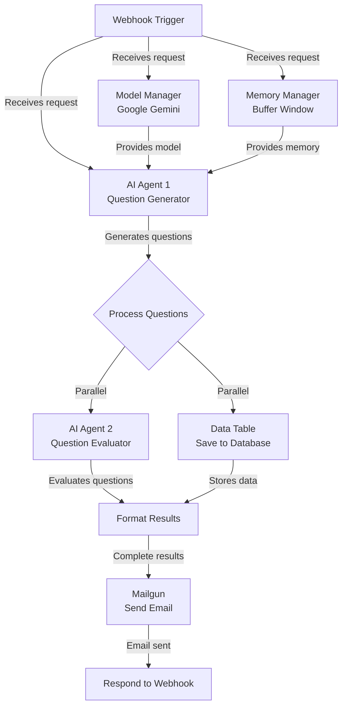
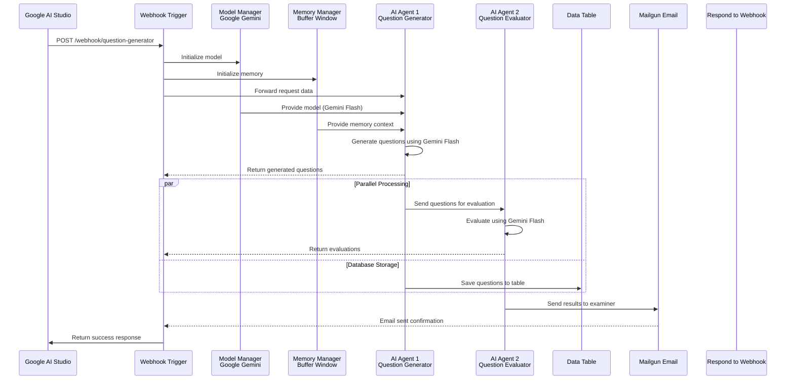

# n8n Workflow Design: AI Question Generator & Evaluator

## Overview

Workflow ini dirancang untuk menerima request dari Google AI Studio via webhook, menghasilkan pertanyaan menggunakan AI Agent (Gemini Flash), mengevaluasi pertanyaan tersebut, menyimpan hasil ke database n8n, dan mengirimkannya ke email penguji melalui Mailgun.

## Workflow Architecture



## Node Details

### 1. Webhook Trigger
- **Node Type**: `n8n-nodes-base.webhook`
- **Purpose**: Menerima HTTP POST request dari Google AI Studio
- **Configuration**:
  - Method: POST
  - Path: `/webhook/question-generator`
  - Response mode: `onReceived`
- **Expected Input**:
  ```json
  {
    "topic": "string",
    "industry": "string",
    "examinerEmail": "string",
    "numberOfQuestions": "number",
    "difficulty": "string"
  }
  ```

### 2. Model Manager
- **Node Type**: `@n8n/n8n-nodes-langchain.lmChatGoogleGemini`
- **Purpose**: Mengelola model AI yang digunakan dalam workflow
- **Configuration**:
  - Model: `gemini-1.5-flash-001`
  - Temperature: `0.7`
  - Credentials: Google Gemini API

### 3. Memory Manager
- **Node Type**: `@n8n/n8n-nodes-langchain.memoryBufferWindow`
- **Purpose**: Mengelola memori percakapan untuk konteks percakapan
- **Configuration**:
  - Session Key: `={{ $json.sessionId || $json.topic }}`
  - Type: Buffer Window Memory

### 4. AI Agent 1 - Question Generator
- **Node Type**: `@n8n/n8n-nodes-langchain.agent` (typeVersion: 3.1)
- **Purpose**: Menghasilkan pertanyaan berdasarkan topic yang diberikan
- **Model**: Gemini Flash 1.5/2.0 (disediakan oleh Model Manager)
- **Memory**: Buffer Memory (disediakan oleh Memory Manager)
- **Configuration**:
  - Prompt Type: `define`
  - Model: `google__gemini-flash`
  - System Prompt:
    ```
    Anda adalah seorang pembuat soal profesional. 
    Anda adalah seorang konsultan bisnis dengan pengalaman lebih dari 20 tahun.
    Sebagai seorang ahli strategi bisnis, silakan tanyakan terlebih dahulu jenis industri dari klien yang ingin diajak berdiskusi.
    Setelah itu, buatlah {{ $json.numberOfQuestions || 5 }} pertanyaan dengan tingkat kesulitan {{ $json.difficulty || 'sedang' }}
    yang relevan dengan jenis industri tersebut dan berdasarkan Business Model Canvas.
    Pastikan pertanyaan mencakup aspek-aspek berikut:

    1. VALUE PROPOSITION (Proposisi Nilai)
    - Masalah apa yang ingin diselesaikan bagi pelanggan?
    - Solusi apa yang ditawarkan? Apa keunikannya?
    - Apakah produk/layanan mengurangi rasa sakit/kerugian atau menciptakan keuntungan?
    - Apa yang membedakan dari kompetitor?
    - Apa manfaat utama yang dirasakan customer (emosi/fungsi)?

    2. CUSTOMER SEGMENTS (Segmen Pelanggan)
    - Siapa target customer? (demografi, psikografi, perilaku)
    - Apakah ada niche market yang spesifik?
    - Apakah customer mass market atau segmented?
    - Apakah ada perbedaan antara pengguna dan yang membayar?
    - Apa kebutuhan dan tantangan terbesar mereka?

    3. CHANNELS (Saluran)
    - Bagaimana cara menjangkau customer? (online/offline)
    - Channel mana yang paling efektif untuk awareness, evaluation, purchase, delivery, after-sales?
    - Apakah menggunakan direct sales, distributor, marketplace, atau kombinasi?
    - Bagaimana integrasi antara channel online dan offline?

    4. CUSTOMER RELATIONSHIPS (Hubungan Pelanggan)
    - Jenis hubungan seperti apa yang ingin dibangun? (personal assist, self-service, automated, community)
    - Bagaimana cara mendapatkan customer (acquisition)?
    - Bagaimana cara mempertahankan customer (retention)?
    - Apakah ada program loyalty atau membership?

    5. REVENUE STREAMS (Aliran Pendapatan)
    - Dari mana uang masuk? (jual produk, subscription, freemium, commission, ads)
    - Berapa harga jual dan strategi pricingnya?
    - Apakah ada multiple revenue streams?
    - Bagaimana cara pembayaran? (one-time, recurring, installment)
    - Berapa estimasi lifetime value customer?

    6. KEY RESOURCES (Sumber Daya Utama)
    - Sumber daya fisik apa yang dibutuhkan? (gedung, mesin, inventory)
    - Sumber daya intelektual apa? (brand, patent, data, software)
    - Sumber daya manusia apa yang kritis? (expertise, skill)
    - Sumber daya finansial apa yang tersedia/dibutuhkan?

    7. KEY ACTIVITIES (Aktivitas Utama)
    - Aktivitas produksi apa yang perlu dilakukan?
    - Aktivitas problem-solving seperti apa?
    - Platform/network management seperti apa?
    - Apa saja aktivitas kritis yang harus berjalan agar Value Proposition tercapai?

    8. KEY PARTNERSHIPS (Kemitraan Kunci)
    - Siapa supplier atau partner strategis?
    - Apa yang didapatkan dari partnership tersebut? (resources, activities, supply chain)
    - Apakah ada joint venture atau strategic alliance?
    - Mana yang lebih baik: make or buy?
    - Apakah ada ketergantungan pada platform tertentu?

    9. COST STRUCTURE (Struktur Biaya)
    - Apa fixed cost terbesar? (salary, rent, utilities)
    - Apa variable cost utama?
    - Apakah cost structure leans toward cost-driven atau value-driven?
    - Apa cost tersembunyi yang sering terlupakan?
    - Berapa break-even point-nya?

    Format output dalam JSON:
    {
      "industry": "jenis industri",
      "questions": [
        {
          "id": 1,
          "question": "pertanyaan",
          "type": "multiple_choice/essay/short_answer",
          "answer": "jawaban benar",
          "options": ["opsi A", "opsi B", "opsi C", "opsi D"],
          "businessCanvasElement": "nama elemen business canvas"
        }
      ],
      "metadata": {
        "topic": "topic",
        "difficulty": "difficulty",
        "generatedAt": "timestamp",
        "industry": "jenis industri"
      }
    }
    ```
- **Output**: JSON dengan daftar pertanyaan

### 5. AI Agent 2 - Question Evaluator
- **Node Type**: `@n8n/n8n-nodes-langchain.agent` (typeVersion: 3.1)
- **Purpose**: Mengevaluasi kualitas dan kelayakan pertanyaan
- **Model**: Gemini Flash 1.5/2.0 (disediakan oleh Model Manager)
- **Memory**: Buffer Memory (disediakan oleh Memory Manager)
- **Configuration**:
  - Prompt Type: `define`
  - Model: `google__gemini-flash`
  - System Prompt:
    ```
    Anda adalah seorang evaluator soal profesional. 
    Anda adalah seorang evaluator soal bisnis profesional.
    Evaluasi setiap pertanyaan berikut berdasarkan kriteria:
    1. Kejelasan pertanyaan (1-5)
    2. Kesesuaian dengan Business Model Canvas (1-5)
    3. Relevansi dengan industri {{ $json.industry }} (1-5)
    4. Tingkat kesulitan yang tepat (1-5)
    5. Kelayakan sebagai soal ujian bisnis (1-5)
    
    Perhatikan apakah pertanyaan mencakup elemen-elemen Business Model Canvas:
    Value Proposition, Customer Segments, Channels, Customer Relationships,
    Revenue Streams, Key Resources, Key Activities, Key Partnerships, dan Cost Structure.
    
    Pertanyaan untuk dievaluasi: {{ $json.questions }}
    
    Format output JSON:
    {
      "evaluations": [
        {
          "questionId": 1,
          "clarity": 4,
          "relevanceToBusinessCanvas": 5,
          "industryRelevance": 4,
          "difficultyMatch": 4,
          "feasibility": 5,
          "overallScore": 4.4,
          "businessCanvasElement": "nama elemen business canvas",
          "feedback": "kritik dan saran perbaikan"
        }
      ],
      "summary": {
        "averageScore": 4.4,
        "totalQuestions": 5,
        "quality": "baik/sedang/kurang",
        "industry": "jenis industri"
      }
    }
    ```
- **Output**: JSON dengan evaluasi setiap pertanyaan

### 6. Data Table - Save to Database
- **Node Type**: `n8n-nodes-base.dataTable` (typeVersion: 1.1)
- **Purpose**: Menyimpan hasil pertanyaan dan evaluasi ke database n8n
- **Configuration**:
  - Resource: `row`
  - Operation: `insert`
  - Data Table: `question_evaluations` (akan dibuat otomatis)
  - Columns Mapping:
    | Column | Value |
    |-------|-------|
    | id | Auto-generated UUID |
    | topic | {{ $json.topic }} |
    | industry | {{ $json.industry }} |
    | questions | JSON.stringify($json.questions) |
    | evaluations | JSON.stringify($json.evaluations) |
    | average_score | {{ $json.summary.averageScore }} |
    | examiner_email | {{ $json.examinerEmail }} |
    | created_at | {{ $now.toISOString() }} |
    | status | 'completed' |

### 7. Send Email (Mailgun)
- **Node Type**: `n8n-nodes-base.mailgun`
- **Purpose**: Mengirimkan hasil pertanyaan dan evaluasi ke email penguji via Mailgun
- **Configuration**:
  - From Email: `{{ $env.MAILGUN_FROM_EMAIL }}`
  - To Email: `{{ $json.examinerEmail }}`
  - Subject: `Hasil Pertanyaan & Evaluasi: {{ $json.topic }}`
  - HTML:
    ```html
    <h2>Hasil Pertanyaan & Evaluasi Bisnis</h2>
    <p><strong>Topik:</strong> {{ $json.topic }}</p>
    <p><strong>Industri:</strong> {{ $json.industry }}</p>
    <p><strong>Tanggal:</strong> {{ $json.created_at }}</p>
    
    <h3>Ringkasan Evaluasi</h3>
    <ul>
      <li>Total Pertanyaan: {{ $json.summary.totalQuestions }}</li>
      <li>Skor Rata-rata: {{ $json.summary.averageScore }}/5</li>
      <li>Kualitas: {{ $json.summary.quality }}</li>
      <li>Industri: {{ $json.industry }}</li>
    </ul>
    
    <h3>Pertanyaan yang Dihasilkan</h3>
    {{ $json.questions }}
    
    <h3>Detail Evaluasi</h3>
    {{ $json.evaluations }}
    
    <hr>
    <p><small>Dibuat oleh AI Question Generator Workflow</small></p>
    ```

### 8. Respond to Webhook
- **Node Type**: `n8n-nodes-base.respondToWebhook`
- **Purpose**: Mengirim response ke Google AI Studio
- **Configuration**:
  - Response Body:
    ```json
    {
      "status": "success",
      "message": "Questions generated and evaluated successfully",
      "data": {
        "topic": "{{ $json.topic }}",
        "industry": "{{ $json.industry }}",
        "totalQuestions": {{ $json.summary.totalQuestions }},
        "averageScore": {{ $json.summary.averageScore }},
        "quality": "{{ $json.summary.quality }}",
        "savedToDatabase": true,
        "emailSent": true
      }
    }
    ```

## Environment Variables Required

```bash
# Di n8n Environment Variables
GEMINI_API_KEY=your_gemini_api_key_here
MAILGUN_API_KEY=your_mailgun_api_key_here
MAILGUN_DOMAIN=your_domain.mailgun.org
MAILGUN_FROM_EMAIL=noreply@yourdomain.com
```

## Connection Flow



## Prerequisites

1. **n8n Installation**: Pastikan n8n sudah terinstall dan berjalan
2. **LangChain Extension**: Install `@n8n/n8n-nodes-langchain` package
3. **Google Gemini API Key**: Dapatkan dari [Google AI Studio](https://aistudio.google.com/)
4. **Mailgun Account**: Buat account di [Mailgun](https://mailgun.com) dan get API key
5. **Model & Memory Nodes**: Pastikan node `lmGoogleGemini` dan `memoryBufferWindow` tersedia di n8n
6. **Data Table**: Buat data table di n8n dengan columns yang diperlukan

## Data Table Schema

Buat data table di n8n dengan struktur berikut:

| Column Name | Data Type | Description |
|------------|-----------|-------------|
| id | Text | Unique identifier (UUID) |
| topic | Text | Topic/questions subject |
| industry | Text | Industry type |
| questions | JSON | Array of generated questions |
| evaluations | JSON | Array of question evaluations |
| average_score | Number | Overall evaluation score |
| examiner_email | Text | Email of the examiner |
| created_at | DateTime | Timestamp of creation |
| status | Text | Status (pending/completed) |
| webhook_data | JSON | Original webhook payload |

## Error Handling

1. **Webhook Errors**: Return proper error response dengan status code
2. **AI Agent Errors**: Add fallback model atau retry mechanism
3. **Email Failures**: Log error dan return partial success
4. **Database Errors**: Add try-catch dan error logging

## Testing the Workflow

1. **Test Webhook**:
   ```bash
   curl -X POST https://your-n8n-instance.com/webhook/question-generator \
     -H "Content-Type: application/json" \
     -d '{
       "topic": "Strategi Bisnis",
       "industry": "Teknologi",
       "examinerEmail": "penguji@example.com",
       "numberOfQuestions": 3,
       "difficulty": "sedang"
     }'
   ```

2. **Expected Response**:
   ```json
   {
     "status": "success",
     "message": "Questions generated and evaluated successfully",
     "data": {
       "topic": "Strategi Bisnis",
       "industry": "Teknologi",
       "totalQuestions": 3,
       "averageScore": 4.2,
       "quality": "baik",
       "savedToDatabase": true,
       "emailSent": true
     }
   }
   ```

## Next Steps

1. [ ] Implement workflow di n8n instance
2. [ ] Configure environment variables
3. [ ] Create data table schema
4. [ ] Test dengan sample requests
5. [ ] Connect dengan Google AI Studio
6. [ ] Monitor dan optimize performance
